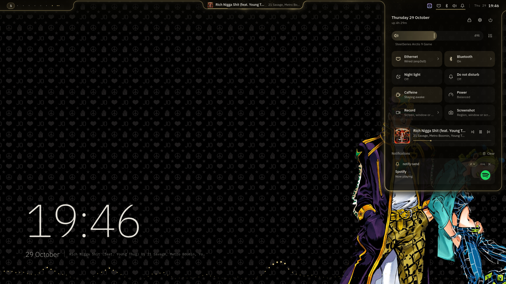
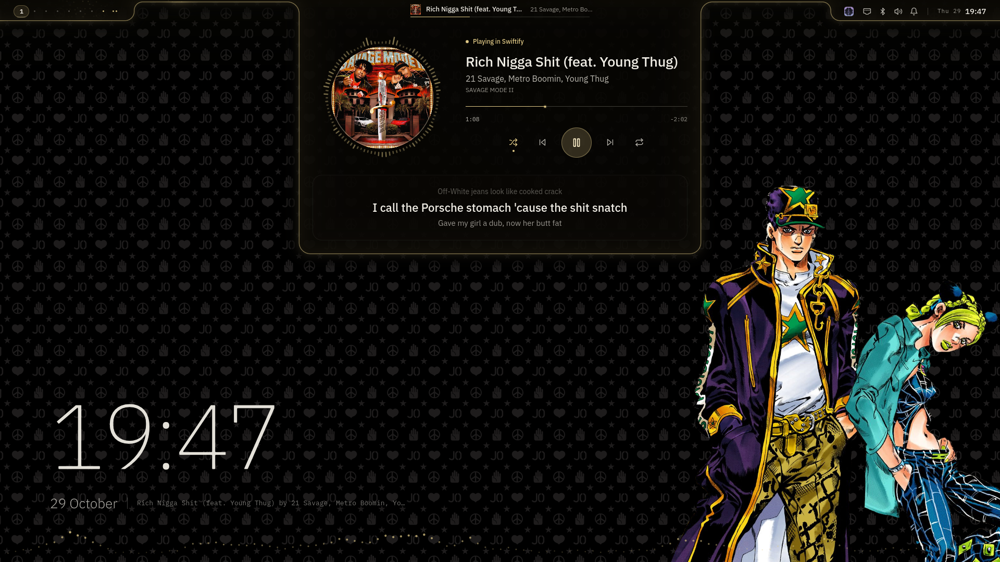
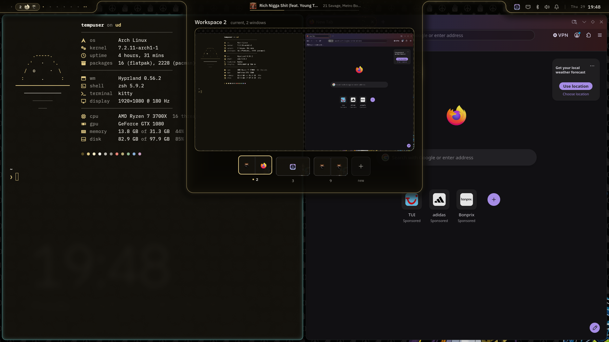
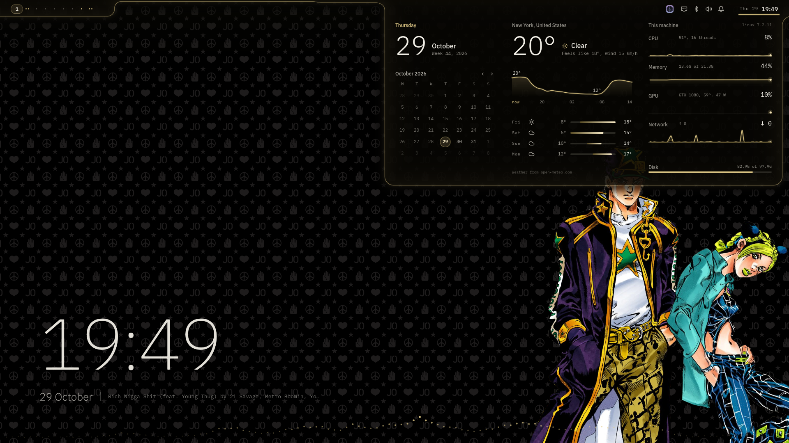
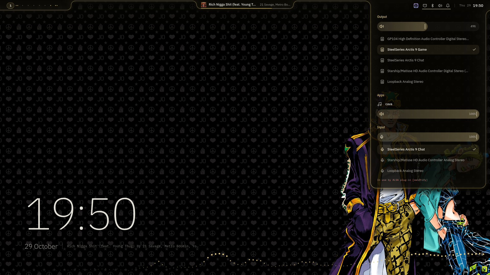
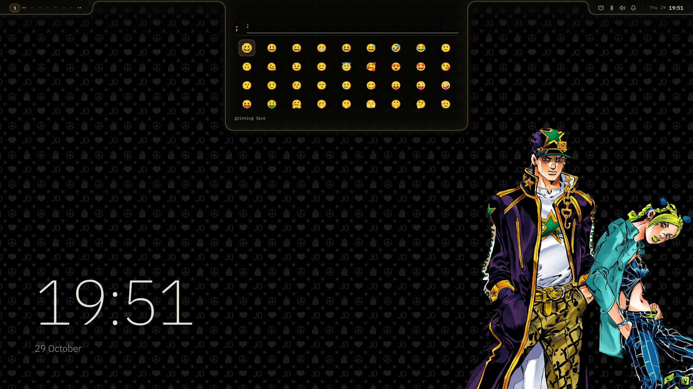
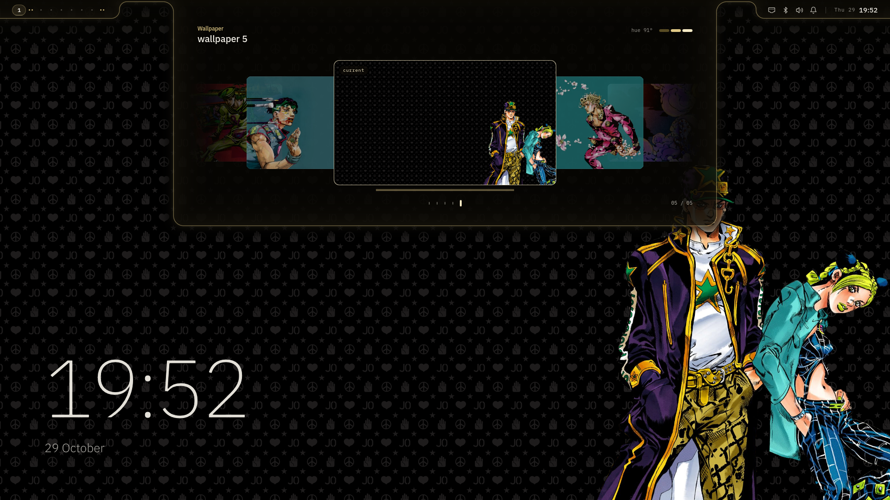
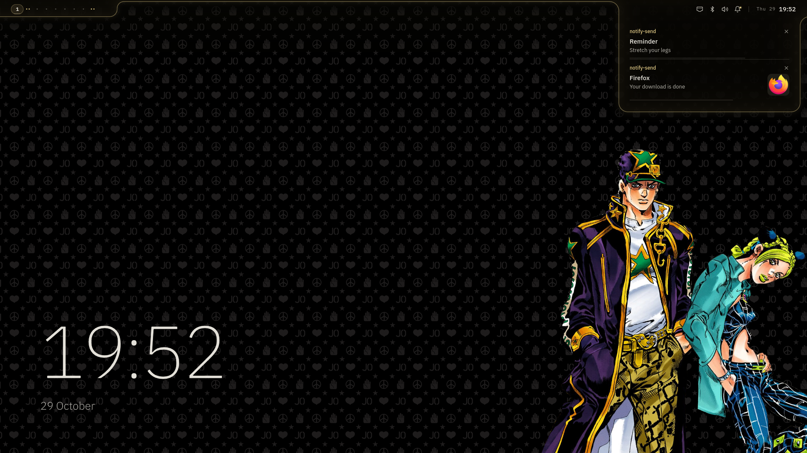
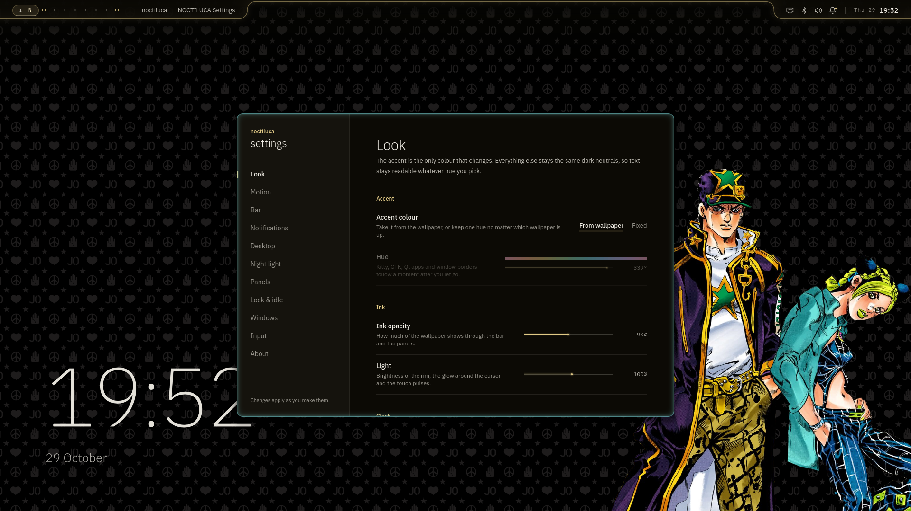
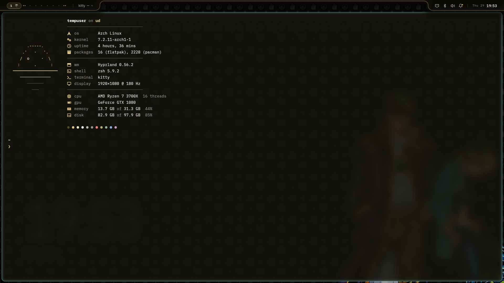

# noctiluca

My Hyprland setup for Arch. The name comes from *Noctiluca scintillans*, the plankton that lights
up when the water moves.



The bar is a strip of dark "ink" along the top with a thin lit edge. Panels slide out of it and
back into it, and clicking it sends a bit of light along the edge. Everything (bar, panels,
launcher, notifications, lockscreen, wallpaper) is one Quickshell config I wrote for this, so no
waybar, rofi, mako or hyprlock. Hyprland itself is configured in Lua.

> This is a beta. I've tested it on Hyprland 0.56.2 and Quickshell 0.3.2 on my own machine and
> not many others yet, so there will be bugs. If you open an issue, paste the output of
> `noctiluca-ctl doctor`.

<p>
  
  
  
  
  
  
  
  
</p>



## What's in it

- bar with workspaces (scroll over them), window title, music, tray, layout, battery, clock
- launcher: apps, windows, settings pages, maths and unit conversion. `/` files, `;` emoji,
  `#` colours, `:` clipboard, `>` run a command
- control centre, dashboard (calendar, weather, system graphs), music player with synced lyrics,
  overview with live windows, volume mixer
- screenshots and screen recording
- wallpaper picker. The accent colour comes from the wallpaper and goes everywhere: shell,
  kitty, GTK, Qt, Hyprland borders. Black and white wallpapers get a silver accent
- lockscreen, and a greetd login screen if you want it
- a settings app (`Super+I`) for basically all of the above, including Hyprland gaps, borders,
  animation speed and keyboard layout. Changes apply right away
- polkit prompt, colour picker, night light, clipboard history with images
- kitty + zsh + fastfetch

## Install

If you already use another Quickshell setup, read [docs/PACKAGES.md](docs/PACKAGES.md) first. This
never touches an installed Quickshell, it builds its own copy in your home.

```bash
git clone https://github.com/u61d/noctiluca ~/noctiluca
cd ~/noctiluca
./install.sh --dry-run    # see what it would do
./install.sh
```

It asks before installing packages, builds Quickshell into `~/.local/opt`, links the configs
into `~/.config` and generates the colours. If something of yours is in the way it gets moved to
`~/.local/state/noctiluca/backups/` (after asking). You can run it again safely, and
`./install.sh --uninstall` removes the links.

After that, put some pictures in `~/Pictures/wallpapers`, log in on a TTY and run `Hyprland`.
`Super+W` picks a wallpaper, `Super+I` is where you set your keyboard layout. If you want
Hyprland to start when you log in, copy `config/zsh/zprofile.example` to `~/.zprofile`.

Want to try it without messing up your current desktop? Make a second user and install it there.
Apart from pacman nothing writes outside your home.

### Updating

Extract the new tarball over the old folder, then get rid of files that were removed since:

```bash
cd ~/noctiluca
git clean -nd      # shows what would go
git clean -fd      # removes it
```

That only touches files the repo doesn't know about. Your `local.lua`, generated colours and
wallpapers are in `.gitignore`, so they stay. Then reload Hyprland (`hyprctl reload`) and restart
the shell.

### Login screen (optional)

```bash
scripts/install-greeter.sh
```

Copies the shell, your colours, wallpaper, `~/.face` and keyboard layout to
`/usr/share/noctiluca/greeter` and points greetd at it. Your old greetd config is kept. Run it
with `--refresh` after changing wallpaper, `--uninstall` to go back. Have a spare TTY ready the
first time.

## Keys

| | |
|---|---|
| `Super` (tap) or `Super+Space` | launcher |
| `Super+V` | clipboard |
| `Super+.` | emoji |
| `Super+A` | control centre |
| `Super+Shift+A` | mixer |
| `Super+D` | dashboard |
| `Super+Tab` | overview (click a window, drag it to another workspace, middle click closes) |
| `Super+M` | music |
| `Super+N` | notifications |
| `Super+W` | wallpapers |
| `Super+I` | settings |
| `Print`, `Super+Shift+S` | screenshot |
| `Super+Shift+R` | record (again to stop) |
| `Super+Shift+C` | colour picker |
| `Super+Ctrl+Space` | next keyboard layout |
| `Super+Ctrl+N` | night light |
| `Super+Escape` | power menu |
| `Super+Ctrl+L` | lock |
| `Super+1`..`9` | workspaces, `Super+Shift+1`..`9` moves the window |
| `Super+Return` | terminal |
| `Super+Q` | close window |

The full list is in [docs/KEYBINDS.md](docs/KEYBINDS.md) (generated from the config, so it's
always current).

## Wallpapers

`Super+W`. As you move through the picker the real desktop changes with it, Enter keeps it and
Escape goes back. From a terminal:

```bash
noctiluca-wallpaper --random
noctiluca-wallpaper --set ~/Pictures/wallpapers/sea.jpg
```

It looks in `~/Pictures/wallpapers`, `~/Pictures/Wallpapers`, `~/.local/share/noctiluca/wallpapers`
and anything in `$NOCTILUCA_WALLPAPERS`. Pictures only (jpg, png, webp, avif, jxl, ...). Videos and
gifs in the folder are just skipped. If you'd rather keep one colour no matter the wallpaper, set
the accent to Fixed in settings.

## Terminal

The installer adds a line to your `~/.zshrc` that loads
[config/zsh/noctiluca.zsh](config/zsh/noctiluca.zsh). That gives you shared history, an arrow-key
completion menu, autosuggestions and syntax highlighting (if installed), eza aliases and this
prompt:

```
~/code/noctiluca on main +* ⇡1  took 3.2s
❯
```

`+` staged, `*` unstaged, arrows for unpushed/unpulled commits. The time shows up when a command
took over 2 seconds, and the arrow turns red when it failed. Old prompts shrink down to just `❯`.

Anything after that line in your `.zshrc` wins. Put these before it to turn things off:

```zsh
NOCTILUCA_FASTFETCH=0
NOCTILUCA_TRANSIENT=0
```

Splits in kitty: `Ctrl+Shift+Enter`, `Ctrl+Shift+\`, and `Ctrl+Alt+Z` to zoom one.

## Problems

**Shell doesn't start.** Run `noctiluca-shell --check` and `noctiluca-shell log`. Most of the time
Qt got updated and Quickshell needs a rebuild: `scripts/build-quickshell.sh`.

**Anything else.** `noctiluca-ctl doctor` checks the usual stuff and tells you what to do.

**No notifications.** Something else (mako, dunst, swaync, another shell) took the notification
bus first. The shell tells you which one. Stop it and the shell takes over.

**Recording says "neither h264, hevc nor av1 are supported".** Your NVIDIA driver is older than
the ffmpeg gpu-screen-recorder was built against. It falls back to recording on the CPU. Update
the driver and reboot to get the GPU back.

**fastfetch shows twice.** Your own `.zshrc` runs it too. Delete that line.

**It locks by itself.** That's the idle lock, 5 minutes by default. Change it in Settings → Lock &
idle. It doesn't lock while music is playing.

**Overview won't load / only shows icons.** Your Quickshell was built without screencopy, run
`./install.sh --build`. If it loads but only shows icons, turn off live previews in Settings →
Panels.

**NVIDIA.** `cat /sys/module/nvidia_drm/parameters/modeset` should print `Y`. If it doesn't, add
`nvidia_drm.modeset=1` to your kernel parameters.

**Everything looks blurry.** Check `hyprctl monitors`. By default it uses your monitor's highest
resolution. If you want a specific mode, set it in `~/.config/hypr/local.lua`, e.g.
`monitor = { mode = "2560x1440@179.95" }` (`hyprctl monitors all` lists what your monitor has).

**Wrong font.** `fc-match "IBM Plex Sans"` should show Plex. If not, install `ttf-ibm-plex`.

**Lockscreen.** It's a real session lock, so if the shell crashes the screen stays locked. Log in
on another TTY (`Ctrl+Alt+F2`) and start the shell again with
`hyprctl -i 0 dispatch 'hl.dsp.exec_cmd("noctiluca-shell")'`. It takes the lock back and you can
unlock normally.

More in [docs/KNOWN-LIMITATIONS.md](docs/KNOWN-LIMITATIONS.md).

## Hacking on it

```
config/hypr/        hyprland config (lua)
shell/              the quickshell config
scripts/            installer helpers, colour stuff, theming
templates/          kitty, gtk, qt, hyprland colour templates
design/tokens.json  spacing, fonts, animation and colour rules shared by hyprland and the shell
tests/              tests/lint.sh runs all of it
```

`tests/lint.sh` runs whatever checks your machine can run (Hyprland config, QML against the
Quickshell API, shaders, the installer in a fake home, ...). [docs/ARCHITECTURE.md](docs/ARCHITECTURE.md)
has a rough map and [docs/DESIGN.md](docs/DESIGN.md) some notes on the look.

## Credits

[Hyprland](https://hypr.land), [Quickshell](https://quickshell.org), [IBM Plex](https://www.ibm.com/plex/),
[Open-Meteo](https://open-meteo.com) for weather, [LRCLIB](https://lrclib.net) for lyrics,
[Lucide](https://lucide.dev) icons and [Nerd Fonts](https://www.nerdfonts.com) symbols. Licences in
[docs/THIRD-PARTY.md](docs/THIRD-PARTY.md).

[caelestia-dots/shell](https://github.com/caelestia-dots/shell) is what got me into Quickshell.
No code was taken from it.

MIT, see [LICENSE](LICENSE).
